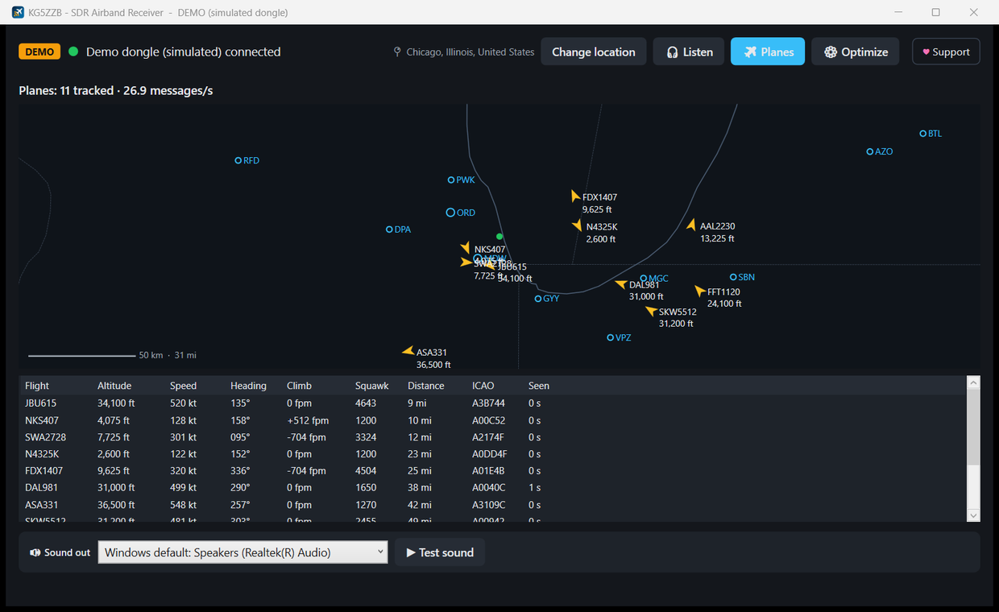

# KG5ZZB - SDR Airband Receiver

**Hear pilots and air traffic control, and see the planes around you on a map, with an inexpensive RTL-SDR USB dongle.**

Plug in the dongle, pick your city, and listen. The app runs offline. Everything comes from your own antenna and receiver; no websites or online feeds stand in for it.

**[⬇ Download the latest version](https://github.com/jeypnet/KG5ZZB-SDR-Airband-Receiver/releases/latest)**: Windows (one `.exe`, nothing to install), plus test versions for Mac and Linux.

## ✨ Highlights

- **🎙 AI noise filter, one button.** A neural network ([RNNoise](https://github.com/xiph/rnnoise)) removes hiss and static, quiet pilots come up to the same loudness as the tower, consonants get crisper, and a limiter keeps it from crackling. Measured through the app's own receiver, with speech recognition counting the words it understood:

  | Signal | Filter off | **Filter on** |
  |---|---|---|
  | Weak | 11% of words | **37%: more than 3× as many** |
  | Medium | 37% | **46%** |
  | Strong | 41% | 41% |

  And 11 dB less static between words at every signal strength. [How it works ↓](#-ai-noise-filter-one-button)
- **🔧 One-click dongle setup.** A brand-new dongle needs a special USB driver. Usually that means a separate tool (Zadig); this app installs it with one click and one Windows prompt, then starts by itself. Tested on real hardware.
- **📻 A real scanner, made simple.** SCAN, HOLD, SKIP, MONITOR and DELAY work like a handheld scanner. Every airport channel within 50 miles of your city is found for you, worldwide.
- **✈ Planes on a map.** The app's own ADS-B decoder shows callsign, altitude, speed, heading and squawk on an offline map. Click an airport to hear its tower.
- **▶ Try it without a dongle.** The demo plays realistic radio conversations on your local channels and flies pretend planes around your city, all through the same radio code.
- **⚙ Optimize.** It tests every gain setting with your antenna and keeps the best one, explained in plain words.
- **💻 Windows, Mac and Linux.** Every change is built and tested automatically on all three.

> **Status: v0.6.2.** Windows: tested with a Nooelec NESDR SMArt v5 on Windows 11. Mac and Linux: built, tested and started automatically on real macOS and Linux machines, but not yet tried with a dongle; reports welcome. See [Compatibility](#compatibility-the-exe).

---

## What it does

### 🎧 Listen to the airband (118–137 MHz AM)
- **Scan:** the default. The app checks the channels near you and stops on any channel with someone talking (towers, ground, approach, ATIS, the 121.5 MHz emergency channel). It holds 2 seconds for the reply, then resumes.
- **Channel by channel:** press **▶ Listen** next to any channel, such as *IAH Tower 127.300*, to stay on it.
- **Hold / Skip**, volume, and **automatic squelch** that adjusts to each channel's own noise level.

### ✈️ See the planes (ADS-B, 1090 MHz)
- The app decodes aircraft transponder broadcasts itself: flight number, altitude, speed, heading, squawk and position.
- Planes appear on an **offline map** and in a list.
- **Click an airport on the map** to tune the radio to its tower.

### 🌍 Works anywhere in the world
- **Choosing a location:** type a city or airport ("Chicago", "Heathrow", "ORD"), or pick **Region → Country → State → City**.
- **Nearby airports load automatically:** choosing a city loads every airport within about 50 miles, roughly how far a dongle can hear.
- **Data:** frequencies for about 11,000 airports in 236 countries come from [OurAirports](https://ourairports.com/data/) open data, bundled with the app, so no internet is needed.

### 🔌 Plug and play
- **One dongle:** switch between **Listen** and **Planes**.
- **Two dongles:** listen and see planes **at the same time**. Each dongle is assigned a role by its serial number and remembered.
- **Settings tuned to your hardware:** on first use the app measures your dongle and antenna for each band (about 30 seconds) and saves the best settings. Use **Optimize** to run it again.

## Why two bands need two setups

| | Airband voice | ADS-B transponders |
|---|---|---|
| Frequency | 118–137 MHz, AM | 1090 MHz, pulse data |
| Sample rate | 2.4 MS/s (scans many channels at once) | 2.0 or 2.4 MS/s, whichever decodes more |
| Gain | Highest gain before strong signals overload the dongle, found by auto-tune | Gain that yields the most valid (CRC-checked) messages per second |
| Antenna | Airband antenna (about 57 cm elements) | 1090 MHz antenna (about 6.9 cm elements) |
| Helpful extras | FM-broadcast filter | 1090 MHz filter + LNA |

A dongle sees about 2.4 MHz of spectrum at a time, so **one dongle cannot do both bands at once**. That is why two-dongle mode exists.

## Compatibility (the `.exe`)

**In short:** a 64-bit Windows 11 PC with an RTL2832U-based RTL-SDR dongle. Nothing else needs to be installed except the dongle's USB driver, once.

| | Status |
|---|---|
| **Tested on** | Windows 11 Pro **25H2** (build 26200), 64-bit, with a **Nooelec NESDR SMArt v5** |
| **Windows 11, 64-bit (x64)** | ✅ Supported |
| **Windows 10, 64-bit (x64)** | ⚠️ Should work: the .NET runtime built into the `.exe` supports Windows 10 version 1607 and later. **Not tested yet.** |
| **Windows on ARM (e.g. Snapdragon laptops)** | ⚠️ Untested. Windows 11 runs x64 apps through emulation, but the USB driver path has not been tried. |
| **32-bit Windows, Windows 7 / 8 / 8.1** | ❌ Not supported |
| **macOS, Linux** | 🧪 **Test versions available**, see [Mac and Linux](#mac-and-linux-test-versions) |

**The `.exe` file**
- **One self-contained file,** `KG5ZZB-SDR-Airband-Receiver.exe` (about 74 MB). It includes the .NET runtime, the RTL-SDR driver library (`rtlsdr.dll` + `libusb-1.0.dll`), the worldwide airport list and the offline map. **No .NET or other install is needed**, and the app works offline.
- **No installer.** Put the file anywhere and double-click it. The first start unpacks its parts to a temporary folder, so it takes a few seconds longer.
- **Not code-signed (yet).** Windows SmartScreen may show "Windows protected your PC". Click **More info → Run anyway**. Some antivirus programs are cautious with new unsigned files.
- **Settings and log** are kept in `%APPDATA%\KG5ZZB-SDR-Airband-Receiver\`. Delete that folder to reset the app.
- **Built on .NET 10 (LTS),** supported by Microsoft with security updates until **November 2028**.

**Dongle**
- **Needed:** an RTL-SDR dongle with the **Realtek RTL2832U** chip (USB ID `0BDA:2838` or `0BDA:2832`), for example Nooelec NESDR, RTL-SDR Blog V3/V4 or generic "RTL2832U + R820T" sticks. Only the **Nooelec NESDR SMArt v5** has been tested. Other dongles supported by osmocom librtlsdr should work.
- **Driver:** the dongle needs the **WinUSB** driver, once per PC. When it's missing, the app shows **🔧 Set up dongle**: one click and one Windows permission prompt (it uses libwdi, the installer inside [Zadig](https://zadig.akeo.ie/)). Zadig by hand still works too.
- **One program at a time:** close SDRangel, SDR# and similar programs before starting the app.
- **Two dongles** (voice + planes at the same time) are supported, but **not tested yet**. Each dongle needs a different serial number.

**Sound:** any Windows sound output (speakers, headphones, HDMI monitor, Bluetooth). Pick it in the **🔊 Sound out** bar.

**Screen:** at least 720 × 520 pixels. The window can be resized.

## Mac and Linux (test versions)

The same app also runs on **macOS** and **Linux**. It has the same screens, the same demo and the same radio code. These are **first test builds**. On every change, GitHub's own Linux and Mac machines build them, run the tests and start the app in demo mode. They have **not yet been used with a dongle on a real Mac or Linux PC**. Please tell us how they work for you (GitHub Issues).

| Download (from [Releases](../../releases)) | For |
|---|---|
| `KG5ZZB-SDR-Airband-Receiver-macos-arm64.zip` | Macs with Apple silicon (M1, M2, M3, M4...), macOS 12 or newer |
| `KG5ZZB-SDR-Airband-Receiver-macos-x64.zip` | Intel Macs, macOS 12 or newer |
| `KG5ZZB-SDR-Airband-Receiver-linux-x64.tar.gz` | 64-bit Linux with a desktop (Ubuntu, Debian, Fedora, Mint, Arch...) |

**Mac, once:**
1. Install [Homebrew](https://brew.sh), then in Terminal: `brew install librtlsdr`.
2. Unzip, move the app to Applications.
3. The app is not signed by Apple yet, so the first time: **right-click the app → Open → Open**. If macOS still refuses, run `xattr -cr "/Applications/KG5ZZB SDR Airband Receiver.app"` in Terminal.

**Linux, once:**
1. Install the RTL-SDR library: `sudo apt install librtlsdr2` (Ubuntu/Debian; older: `librtlsdr0`), `sudo dnf install rtl-sdr` (Fedora) or `sudo pacman -S rtl-sdr` (Arch).
2. Stop the TV driver from taking the dongle: `echo 'blacklist dvb_usb_rtl28xxu' | sudo tee /etc/modprobe.d/blacklist-rtl-sdr.conf`, then unplug and replug the dongle.
3. Unpack and run `./KG5ZZB-SDR-Airband-Receiver`. `README-LINUX.txt` in the download has all the steps.

No driver setup is needed on Mac or Linux (that is only a Windows thing). Settings and the log are in `~/Library/Application Support/KG5ZZB-SDR-Airband-Receiver/` (Mac) or `~/.config/KG5ZZB-SDR-Airband-Receiver/` (Linux).

## Hardware

- **Dongle:** any RTL2832U-based RTL-SDR. Developed and tested on a **Nooelec NESDR SMArt v5** (R820T-family tuner, 0.5 ppm TCXO).
- **Driver:** the dongle needs the **WinUSB** driver. The app installs it with one click (**🔧 Set up dongle**), or you can use [Zadig](https://zadig.akeo.ie/).
- **Antenna:** a reasonable airband antenna makes the biggest difference. Add a 1090 MHz antenna (and a second dongle) for planes and voice together.

## Using it

1. **Driver, once per PC:** plug in the dongle and start the app. If the driver is missing, press **🔧 Set up dongle** and click **Yes** when Windows asks for permission. It takes about 30 seconds, then the app starts by itself. If that doesn't work, use [Zadig](https://zadig.akeo.ie/): Options → List All Devices → the dongle's "Bulk-In, Interface 0" → WinUSB → Replace Driver.
2. **Start `KG5ZZB-SDR-Airband-Receiver.exe`.** Close SDRangel, SDR# and similar programs first, because only one program can use a dongle.
3. **Pick your location:** type a city or airport code, or choose Region → Country → State → City.
4. **Wait for auto-tune.** The first time, the app spends about 10 s measuring your dongle and antenna, then starts scanning.
   - **SCAN** stops on any channel with activity, waits 2 s after it goes quiet, then moves on.
   - **The channel you are hearing is highlighted in the list** with a badge: **🔒 HOLDING**, **🔊 LISTENING** (picked with ▶ Listen) or **🔊 ON AIR** (someone talking during a scan).
   - **DELAY** (on by default, like the DLY key on a scanner): after someone stops talking, the scanner stays on that channel for 2 seconds so you also hear the answer (the pilot calls, the tower replies). Turn it off to jump to the next channel right away. While it waits, the caption says *DELAY · WAITING FOR THE REPLY*.
   - **HOLD** stops the scan and stays on a channel. If the scanner is stopped on a channel, it stays there. If it is still searching, it stays on the last channel that had activity, or else the one with the strongest signal on the last pass. Press HOLD again to resume scanning.
   - **SKIP** leaves the channel the scanner stopped on and keeps scanning. The scanner won't stop on that channel again for 1 minute. Use it when one channel keeps interrupting the scan. The button is greyed out when the scanner isn't stopped on a channel.
   - **▶ Listen** on a channel stops scanning and stays on that channel only. Its button then reads **⟲ Back to scan**: click it (or the row, or SCAN) to go back to scanning.
5. **Choose what gets scanned.** Every channel starts ticked; untick any you don't want. ATIS/AWOS/ASOS weather broadcasts never stop, so the scanner listens to each one for 8 seconds, then moves on and skips it for 2 minutes. To hear one in full, use its ▶ button.
6. **Squelch:** sets how far above the background noise a signal must be before you hear it, from 0 to 20 dB. The label under the slider shows the current value, and the status line shows the strongest signal found, so you can compare the two. All the way left (0) is **open**: the scanner stops right away and you hear everything, static included. Raise it until the static stops and only real transmissions get through.
7. **See planes:** the app always starts on **🎧 Listen**; press **✈ Planes** to switch. With two dongles, both run at the same time. Click an airport on the map to hear its tower.

### Sound: pick your speakers, test them, hear static

The **🔊 Sound out** bar at the bottom of the window is always visible.

- **Pick an output:** the list shows every speaker, headset and HDMI/monitor output by name. The first entry follows the Windows default. When you pick one, it plays the test sound so you know it's the right one, and the app remembers your choice.
- **▶ Test sound:** plays **KG5ZZB in Morse code** (`-.- --. ..... --.. --.. -...`, 700 Hz at 30 words per minute, about 3 s). It plays on its own track, mixed over the radio audio, so the receiver can't cut it short. Nothing heard? Pick another output and check the Windows volume.
- **MONITOR** (next to SCAN / HOLD, like the MONI key on a handheld): the app is **silent until someone transmits** (that's what the squelch does). MONITOR opens the squelch so you hear the channel anyway: background hiss, or a weak signal under the squelch. **Hold it** to open the squelch only while held, or **click it** to keep it open (it lights up amber), and click again to close. While scanning it also stays on a channel so there is something to hear, and turning it off resumes the scan. The S-meter then shows **SQ OPEN · MONITOR**. MONITOR is always off when the app starts.

### What "⚙ Optimize" does

Your dongle has 29 gain (amplification) settings. The best one depends on your antenna, cable, filter and how close you are to strong transmitters, so the app **measures it instead of guessing**.

- **For listening (airband):**
  - The app steps through every setting and counts how often the signal overloads the dongle (raw samples hitting the 8-bit limit, which distorts the sound).
  - It keeps **the strongest setting with almost no overload** (under 0.1%).
  - If the background noise already rises as fast as the gain, it tells you that more gain wouldn't help you hear weaker aircraft.
- **For planes (ADS-B):** the app tries the top settings for 2 seconds each and keeps **the one that decodes the most aircraft messages**. If no aircraft are heard at all, it says so; that usually means the antenna isn't made for 1090 MHz.
- **How long it takes:** about 10 s for listening and about 16 s for planes. Sound and plane tracking pause while it runs.
- **When it runs:** automatically the first time the app sees a dongle. After that, press **⚙ Optimize** when you change the antenna, filter or cable, move somewhere else, or plug in a different dongle.
- **What you see:**
  - Before it starts, a window explains all this and shows your current settings.
  - When it finishes, a window explains the result in plain words. For example: *"Listening: gain set to 22.9 dB. This is the strongest setting where strong nearby signals don't overload your dongle. Higher settings distorted up to 6.7% of the signal."*

### 🎙 AI noise filter (one button)

Press **AI NOISE FILTER** to make voices **clear, crisp and loud**. It does four things at once:
1. **AI noise removal.** [RNNoise](https://github.com/xiph/rnnoise), a small neural network from xiph.org, removes hiss and static and keeps the voice. A little of the original sound is kept underneath, so no words get cut.
2. **Crispness.** A gentle boost around 2.6 kHz, where the consonants are.
3. **Even loudness.** Quiet pilots come out as loud as the tower. The level only changes while someone is talking, so static is never turned up.
4. **A limiter.** It can be loud without crackling.

Measured on the demo radio through the app's own receiver (Windows speech recognition counting the ATIS words it understood):

| Signal | Words understood, off | **On** | Static between words |
|---|---|---|---|
| Weak | 11% | **37%** | 11 dB quieter |
| Medium | 37% | **46%** | 11 dB quieter |
| Strong | 41% | **41%** | 11 dB quieter |

The setting is remembered. It works the same on Windows, Mac and Linux.

### Demo mode (no dongle needed)

No dongle yet? When no dongle is plugged in, the app shows a **▶ Try the demo** button. It runs the app on a **pretend dongle**, and everything goes through the app's real radio code:

- **🎧 Listen:** made-up but typical radio conversations (tower, ground, clearance, approach, center, CTAF) play on matching channels of the location you picked, with pilots answering controllers. An ATIS broadcast plays on loop. The voices are computer-generated and processed to sound like aircraft radio.
- **✈ Planes:** about ten pretend planes fly around your location and send real ADS-B messages (callsign, position, altitude, speed, heading, squawk), which the decoder puts on the map.
- A strong pretend signal gives **⚙ Optimize** something real to find.

A **DEMO** badge shows while it runs. **■ Stop demo** ends it, and plugging in a real dongle ends it by itself. You can also start the app with `--demo` (or set `KG5ZZB_DEMO=1`) to stay in the demo even with a dongle plugged in.

Settings and the log are kept in `%APPDATA%\KG5ZZB-SDR-Airband-Receiver\`.

## What has been tested

| Area | How | Result |
|---|---|---|
| ADS-B decoding | Reference messages and answers from *The 1090 MHz Riddle* | Callsign, altitude, position (global and local decoding), velocity and CRC all correct |
| ADS-B demodulator | Synthesized 2 MS/s Mode S signals, split across buffers | Every message found |
| AM receiver | Synthesized AM tone with a strong signal on the next 25 kHz channel | Tone recovered; adjacent channel rejected by more than 20 dB |
| Scanner | Simulated dongle: one active channel among quiet ones | Stops on the active channel and plays audio; keeps scanning when all channels are quiet |
| Airport data | Embedded OurAirports data | A large US city: 25 airports and 49 airband channels; junk entries such as "TWR 29.02" removed |
| **Real dongle** (NESDR SMArt v5) | A hardware test tool plus the app, driven through UI Automation | 6 scan groups, full pass in 0.55 s. On a real carrier the scanner stopped and played audio (21 dB above noise). |
| Auto-tune on a real dongle | Gain sweep | Picks the highest gain without overload and explains the choice |
| USB robustness | Real dongle | Transient USB errors on tune/gain commands are retried automatically |
| Single `.exe` | Run alone from an empty folder | Starts and loads its bundled dongle drivers |
| Sound output | Demo mode, app output recorded to a WAV file | Lists the real devices (e.g. "Speakers (Realtek(R) Audio)", HDMI monitor), opens the chosen one (192 kHz stereo device: converted correctly), test beeps and the simulated tower reach the output |
| Controls on a real dongle | UI Automation | All 49 channels of a large US city ticked. HOLD while searching stayed on the strongest channel, and HOLD again resumed. Squelch at 0 stopped the scan and played audio; at 8 it scanned again |
| Morse test sound | App output recorded, then decoded | Decodes back to `-.- --. ..... --.. --.. -...` = KG5ZZB |
| Optimize | Demo mode, driven through UI Automation | The explanation window opens, Start runs the gain sweep, and the result window explains the choice in plain words |
| Demo dongle | Unit tests + live app | Pretend planes' ADS-B messages decode back exactly (callsign, position, speed, squawk); conversations land on matching channels; the scanner stops on them |
| AI noise filter | Demo ATIS at three signal strengths through the real receiver, scored by speech recognition; unit tests | More words understood at weak and medium strength, 11 dB less static, never clips, static never pumped up |
| Mac and Linux | GitHub Actions on real macOS (Apple silicon) and Ubuntu machines | Unit tests pass; the app starts, finds librtlsdr, runs the demo; screenshot saved. Not yet tried with a dongle |

## Support the project

The app is free and always will be. If it helps you hear the sky, you can buy me a coffee on **[Ko-fi](https://ko-fi.com/kg5zzb)**. Donations pay for antennas, dongles and test gear. Thank you!

## Legal

Listening to aviation radio is legal in the United States and many other countries, but **some countries restrict it**. Check your local laws. This software is for receiving only; it does not transmit.

## License

**Free to use.** You may download, install and use the app for free, privately or at work, and share the download link. The source code is not public. All rights reserved © 2026 KG5ZZB. You may not modify, decompile, resell or redistribute modified copies. This applies from v0.6.3; versions up to v0.6.2 were published earlier under GPL-3.0, and those copies keep that license. Full text: [LICENSE](LICENSE).

## Third-party software inside the app

The app includes these open-source components, each under its own license:

| Component | Used for | License |
|---|---|---|
| [osmocom librtlsdr](https://osmocom.org/projects/rtl-sdr/wiki) (`rtlsdr.dll`) | Talking to the RTL-SDR dongle (Windows) | GPL-2.0-or-later. Source: https://gitea.osmocom.org/sdr/rtl-sdr |
| [libusb](https://libusb.info/) (`libusb-1.0.dll`) | USB access (Windows) | LGPL-2.1 |
| [libwdi](https://github.com/pbatard/libwdi) (wdi-simple) | One-click WinUSB driver setup (Windows) | LGPL-3.0, with Microsoft WDK redistributable components |
| [RNNoise](https://github.com/xiph/rnnoise) | AI noise filter | BSD-3-Clause |
| [Avalonia UI](https://avaloniaui.net/) | Mac and Linux app window | MIT |
| [NAudio](https://github.com/naudio/NAudio) | Sound output (Windows) | MIT |
| [OpenAL Soft](https://openal-soft.org/) via Silk.NET | Sound output (Mac and Linux) | LGPL-2.0 / MIT |
| [.NET](https://dotnet.microsoft.com/) | Runtime built into the app | MIT |
| [OurAirports](https://ourairports.com/data/) | Airports and frequencies worldwide | Public domain |
| [Natural Earth](https://www.naturalearthdata.com/) | Offline map outlines | Public domain |
