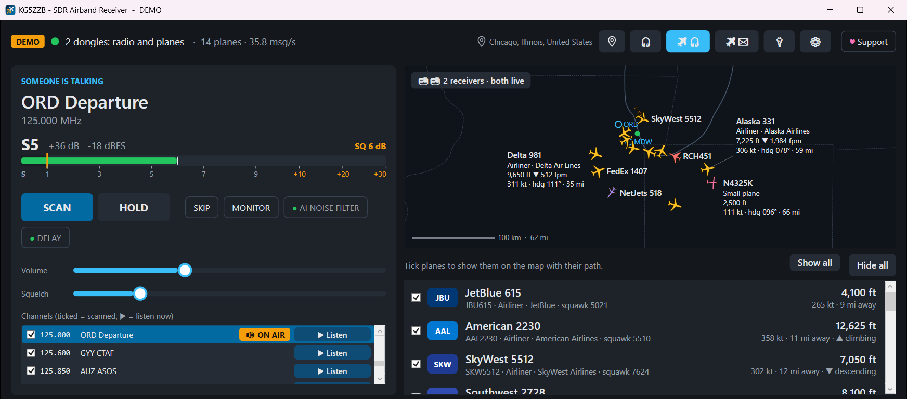
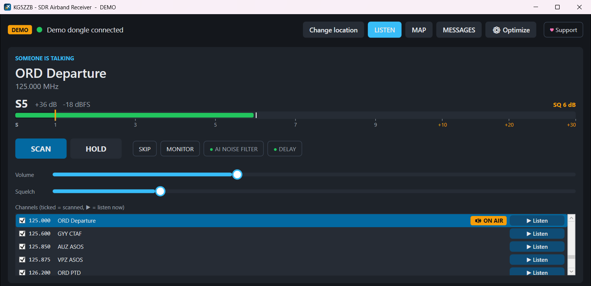
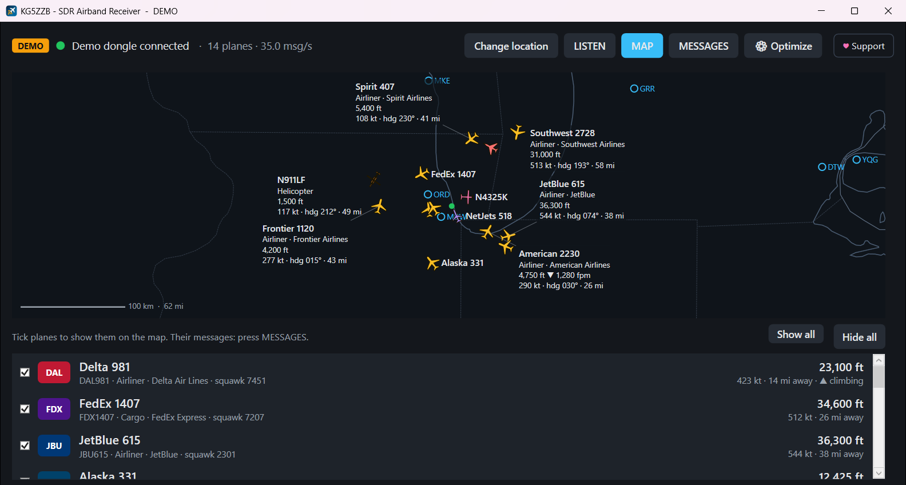
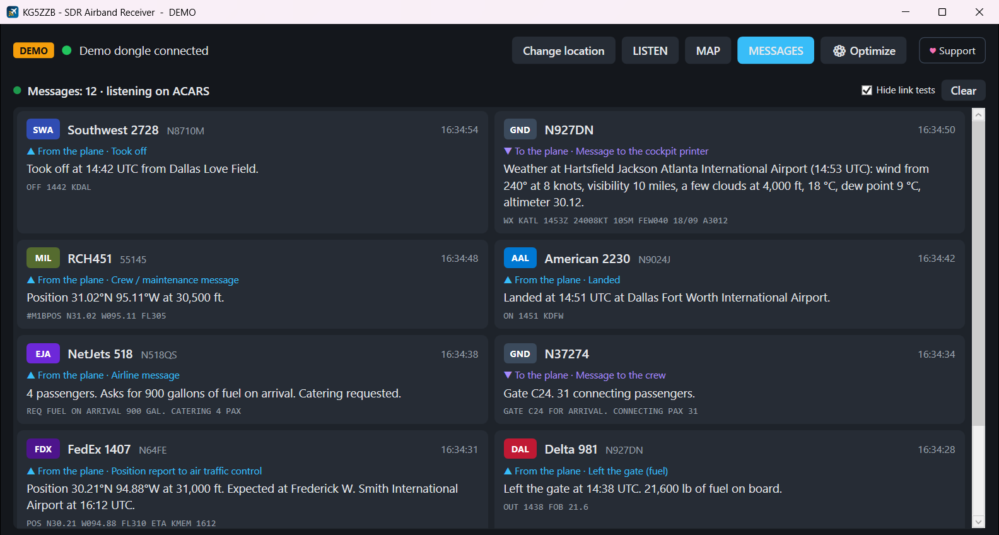

# ✈ KG5ZZB SDR Airband Receiver

**Hear pilots and air traffic control, see the planes around you on a map and read the messages they send,** 
**with an inexpensive RTL-SDR USB dongle.** Everything from your own antenna, offline.

 

 
**Free 30-day trial** · Windows 10/11 · no install, just unzip

**[Full guide, measurements and all downloads → KG5ZZB Radio Apps](https://github.com/jeypnet/KG5ZZB-Radio-Apps)**

| 🎧 **LISTEN** | ✈ **MAP** | ✉ **MESSAGES** |
|:---:|:---:|:---:|
|  |  |  |
| A scanner for pilots and air traffic control, channels found for you | Every plane around you on an offline map | Plane messages explained in one simple sentence |

- 🎙 **AI noise filter:** clearer voices with one button.
- ⚡ **Our own RTL-SDR driver:** the scanner twice as fast as with the free driver. [See the measurements](https://github.com/jeypnet/KG5ZZB-Radio-Apps/blob/main/docs/airband-driver.md).
- 🔧 **One-click dongle setup** on Windows.
- 📻 **Two receivers, plug and play:** MAP + VOICE or MAP + MESSAGES, side by side.
- ▶ **Try the demo** without a dongle.

Older version 0.6.2 stays available here under [Releases](../../releases) for old links.

All rights reserved © 2026 KG5ZZB ([LICENSE](LICENSE)). Third-party components: [THIRD-PARTY-NOTICES.md](THIRD-PARTY-NOTICES.md). Support the project on [Ko-fi](https://ko-fi.com/kg5zzb).
